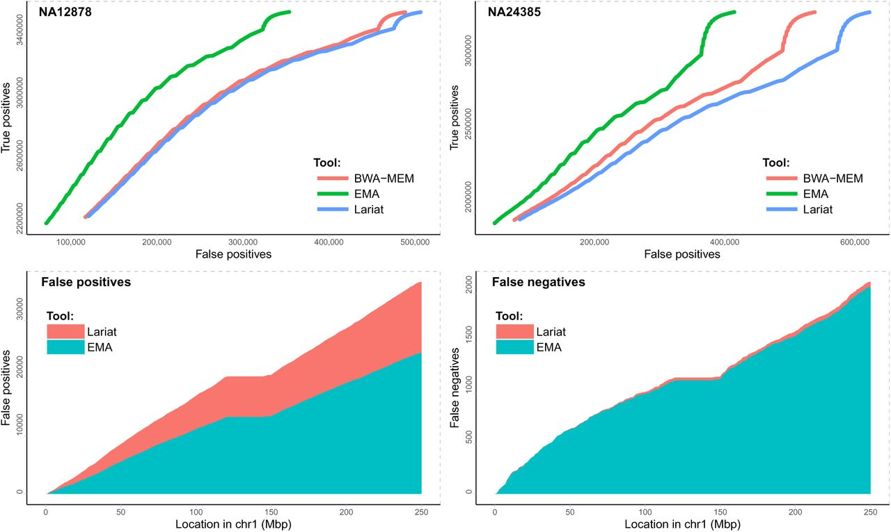
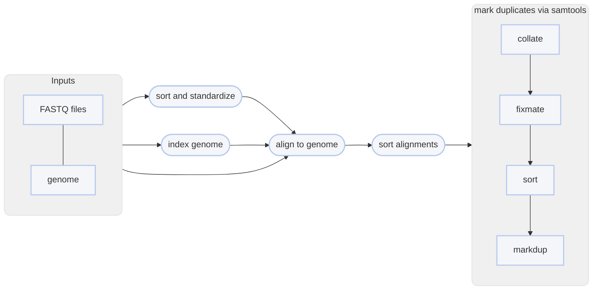

import { Aside, Badge, FileTree, Tabs, TabItem } from '@astrojs/starlight/components';
import Accordion from '@/components/Accordion.astro';

Once sequences have been trimmed and passed through other QC filters, they will need to
be aligned to a reference genome. Arachne is the successor to lariat and EMA, the linked-read aware aligners
developed by 10X Genomics and [Shajii _et al._](https://www.biorxiv.org/content/10.1101/220236v1),
respectively. It incorporates linked-read information to better place alignments, which tends to show
improvement when aligning over repetitive regions.


<Accordion title="📝 You will need">
- at least 4 cores/threads available
- a genome assembly in FASTA format: <Badge variant="success" text=".fasta"/> <Badge variant="success" text=".fa"/> <Badge variant="success" text=".fasta.gz"/> <Badge variant="success" text=".fa.gz"/> <Badge text="case insensitive"/>
- paired-end **linked-read** fastq sequence files <Badge text="gzipped recommended"/>
  - **sample name**: <Badge variant="success" text="a-z"/> <Badge variant="success" text="0-9"/> <Badge variant="success" text="."/> <Badge variant="success" text="_"/> <Badge variant="success" text="-"/> <Badge text="case insensitive"/>
  - **forward**: <Badge variant="success" text="_F"/> <Badge variant="success" text=".F"/> <Badge variant="success" text=".1"/> <Badge variant="success" text="_1"/> <Badge variant="success" text="_R1_001"/> <Badge variant="success" text=".R1_001"/> <Badge variant="success" text="_R1"/> <Badge variant="success" text=".R1"/> 
  - **reverse**: <Badge variant="success" text="_R"/> <Badge variant="success" text=".R"/> <Badge variant="success" text=".2"/> <Badge variant="success" text="_2"/> <Badge variant="success" text="_R2_001"/> <Badge variant="success" text=".R2_001"/> <Badge variant="success" text="_R2"/> <Badge variant="success" text=".R2"/> 
  - **fastq extension**: <Badge variant="success" text=".fq"/> <Badge variant="success" text=".fastq"/> <Badge text="case insensitive"/>
  - supported technologies: haplotagging, BLink-seq, TELL-seq, stLFR, anything in [standard format](https://blinkseq.github.io/lastq/)
</Accordion>
<Accordion title="Linked-reads improve mapping in repetitive regions">
Arachne defaults to using an improved version of the EM algorithm from [EMA](https://www.biorxiv.org/content/10.1101/220236v1),
but can use the RFA algorithm from Lariat with the `--rfa` flag. Regardless of which algorithm you choose, incorporating linked-read
information during mapping improves accuracy over barcode-naive alignment, as shown in [Shajii _et al._, 2017](https://www.biorxiv.org/content/10.1101/220236v1) :


</Accordion>

You can map linked reads onto a genome assembly with harpy using the `align arachne` command:

```bash title="Usage"
harpy align arachne OPTIONS... REFERENCE INPUTS...
```
```bash title="Example"
harpy align arachne genome.fasta Sequences/ 
```

## Running Options
In addition to the [common runtime options](../../getting-started/common-options), the `align arachne` command
largely borrows the same form as the `align` commands and is configured using these command-line arguments:

| argument                   | default | description                                                                                                                                 |
| :------------------------- | :-----: | :------------------------------------------------------------------------------------------------------------------------------------------ |
| `REFERENCE`                |         | Reference assembly for read mapping <Badge variant="tip" text="required"/>                                                                  |
| `INPUTS`                   |         | Files or directories containing [input FASTQ files](/getting-started/common-options#input-arguments) <Badge variant="tip" text="required"/> |
| `--10x`                    |  false  | Input FASTQ are 10X data with inline barcodes                                                                                               |
| `-depth-window` `-w`       | `50000` | Interval size (in bp) for depth stats                                                                                                       |
| `--keep-unmapped` `-u`     |  false  | Output unmapped sequences too                                                                                                               |
| `--molecule-distance` `-d` |   `0`   | Base-pair distance threshold to separate molecules given as base pairs, disabled with `0`                                                   |
| `--min-quality` `-q`       |  `30`   | Minimum `MQ` (SAM mapping quality) to pass filtering                                                                                        |
| `--rfa`                    |  false  | Use the Lariat RFA algorithm instead of the EM from EMA                                                                                     |

## 10X input data
The `arachne prep` step can convert 10X data into standard format using an embedded `4M-with-alts-february-2016.txt`,
which is the official 10X barcode whitelist. Here, "10X data" refers to FASTQ files where the barcodes are still at the
beginning of the R1 sequence:


## RFA vs EM
Internal benchmarks on synthetic data show a marginal improvement in correct read placement in repetitive regions
using the EM (EMA) algorithm as compared to the RFA algorithm from Lariat. The EMA preprint suggests it's better
overall (see above) on real and synthetic data. Your mileage may vary, but the option exists to use `--rfa` to revert to the RFA
algorithm from Lariat.

## Workflows
The arachne workflow is mostly the same as the other aligners, except it preprocesses input FASTQ files
to be converted into standard format and sorted by barcode so that the data works with arachne.
<Tabs>
<TabItem label="workflow">

</TabItem>
<TabItem label="output">
The default output directory is `Align/aligner` with the folder structure below.
`Sample1` is a generic sample name for demonstration purposes. The resulting folder also includes a `workflow` directory
(not shown) with workflow-relevant runtime files and information.

<FileTree>
- Align/aligner
  - aligned
    - Sample1.bam
  - logs
  - reports
    - data
      - lrsats
      - coverage
    - linkedreads.summary.ipynb
    - aligner.summary.ipynb
    - Sample1.ipynb
</FileTree>

| item                                | description                                                                            |
| :---------------------------------- | :------------------------------------------------------------------------------------- |
| `aligned/*.bam`                     | sequence alignments for each sample                                                    |
| `aligned/*.bai`                     | sequence alignment indexes for each sample                                             |
| `reports/`                          | various counts/statistics/reports relating to sequence alignment                       |
| `reports/barcodes.summary.ipynb`    | report summarizing barcode-specific metrics across all samples                         |
| `reports/aligner.summary.ipynb`     | report summarizing `samtools stats` of raw and processed alignments across all samples |
| `reports/Sample1.ipynb`             | report summarizing BX tag metrics and alignment coverage                               |
| `reports/data/coverage/*.cov.gz`    | output from mosdepth, used for reports                                                 |
| `reports/data/coverage/*.molcov.gz` | molecular coverage stats, used for reports                                             |
| `reports/data/lrstats`              | tabular data containing the information used to generate the BX stats in reports       |
</TabItem>
</Tabs>