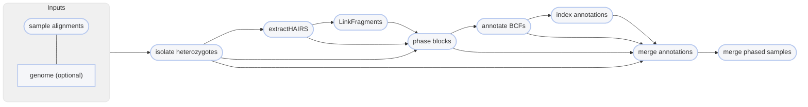

import { Badge, FileTree, Tabs, TabItem } from '@astrojs/starlight/components';
import Accordion from '@/components/Accordion.astro';


<Accordion title="📝 You will need">
- at least 2 cores/threads available
- sequence alignments: <Badge variant="success" text=".bam"/> <Badge text="coordinate-sorted"/>
    - **sample name**: <Badge variant="success" text="a-z"/> <Badge variant="success" text="0-9"/> <Badge variant="success" text="."/> <Badge variant="success" text="_"/> <Badge variant="success" text="-"/> <Badge text="case insensitive"/>
- a variant call format file of genotypes: <Badge variant="success" text=".vcf"/> <Badge variant="success" text=".bcf"/>
- (optional) a reference genome in FASTA format: <Badge variant="success" text=".fasta"/> <Badge variant="success" text=".fa"/> <Badge variant="success" text=".fasta.gz"/> <Badge variant="success" text=".fa.gz"/> <Badge text="case insensitive"/>

</Accordion>


You may want to phase your genotypes into haplotypes, as haplotypes tend to be more informative
than unphased genotypes (higher polymorphism, captures relationship between genotypes). Phasing
genotypes into haplotypes requires alignment files, such as those produced by `align bwa`
and a variant call file, such as one produced by `snp freebayes` or `impute`. **Phasing only works on SNP/indel data**,
and will not work for structural variants (such as those produced by `sv leviathan`), preferably
[filtered in some capacity](../../resources/filtering-snps). You can phase genotypes into haplotypes with
Harpy using the `phase snp` command:

```bash title="Usage"
harpy phase snp OPTIONS... VCF INPUTS...
```
```bash title="Example: phase variants using auto-detected linked-read data"
harpy phase snp --threads 20 Variants/variants.raw.bcf alignments/ 
```

## Running Options
In addition to the [common runtime options](../../getting-started/common-options), the `phase` command is configured using these command-line arguments:


| argument                   | default  | description                                                                                                                  |
| :------------------------- | :------: | :--------------------------------------------------------------------------------------------------------------------------- |
| `VCF`                      |          | <Badge variant="tip" text="required"/> Path to BCF/VCF file                                                                  |
| `INPUTS`                   |          | <Badge variant="tip" text="required"/> Files or directories containing [input BAM files](../../getting-started/input-format) |
| `--contigs`                |          | [Contigs to plot](../../getting-started/common-options#contigs) in the report                                                |
| `--extra-params` `-x`      |          | Additional Hapcut2 arguments, in quotes                                                                                      |
| `--reference` `-r`         |          | Path to reference genome if wanting to also use reads spanning indels                                                        |
| `--min-map-qual` `-q`      |   `20`   | Minimum mapping quality score to be considered for phasing                                                                   |
| `--min-map-qual` `-m`      |   `13`   | Minimum base quality score to be considered for haplotype fragment inclusion                                                 |
| `--molecule-distance` `-d` | `100000` | Base-pair distance threshold to separate molecules                                                                           |
| `--prune-threshold` `-p`   |   `30`   | PHRED-scale (%) threshold for pruning low-confidence SNPs                                                                    |
| `--vcf-samples`, `-V`      |          | [Use samples present in vcf file](#prioritize-the-vcf-file) for phasing rather than those found the directory                |

### Prioritize the vcf file
By default, Harpy assumes you want to use all the samples
present in the `INPUTS` and will inform you of errors when there is a mismatch between the sample files
present and those listed in the `VCF` file. You can instead use the `--vcf-samples` flag if you want
Harpy to build a workflow around the samples present in the `VCF` file. When using this toggle, Harpy
will inform you when samples in the `VCF` file are missing from the provided `INPUTS`.  

The molecule distance and pruning thresholds are considered the most impactful parameters
for running HapCut2.

### Molecule distance
The molecule distance refers to the base-pair distance dilineating separate molecules.
In other words, when two alignments on a single contig share the same barcode, how far
away from each other are we willing to say they were and still consider them having 
originated from the same DNA molecule rather than having the same barcodes by chance.
Feel free to play around with this number if you aren't sure. A larger distance means
you are allowing the program to be more lenient in assuming two alignments with the
same barcode originated from the same DNA molecule. The HapCut2 default is `20000` (20kbp),
but Harpy's default is more lenient with `100000` (100kbp). Unless you have strong evidence
in favor of it, a distance above `250000` (250kbp) would probably do more harm than good.
See [Barcode Thresholds](https://blinkseq.github.io/linkedreads/clashing/#barcode-thresholds) for a more thorough explanation.

### Pruning threshold
The pruning threshold refers to a PHRED-scale value between 0-1 (a percentage) for removing
low-confidence SNPs from consideration. With Harpy, you configure this value as an integer 
between 0-100, (_i.e._ `-p 30` is equivalent to a 0.30 threshold, aka 30%).

## Phasing Workflow
<Tabs>
<TabItem label="details">
Phasing is performed using [HapCut2](https://github.com/vibansal/HapCUT2). Most of the tasks cannot
be parallelized, but HapCut2 operates on a per-sample basis, so the workflow is parallelized
across all of your samples to speed things along.


</TabItem>
<TabItem label="phasing output">
The default output directory is `Phase` with the folder structure below. `Sample1` is a generic sample name for demonstration purposes.
The resulting folder also includes a `workflow` directory (not shown) with workflow-relevant runtime files and information.

<FileTree>
- Phase/
  - variants.phased.bcf
  - variants.phased.bcf.csi
  - annotations
    - Sample1.annot.gz
    - Sample1.annot.gz.tbi
  - extractHairs
    - Sample1.unlinked.frags
  - workflow/input
    - header.names
    - Sample1.bcf
    - Sample1.het.bcf
  - linkFragments
    - Sample1.linked.frags
  - logs/
  - reports
    - blocks.summary.gz
    - phase.ipynb
  - phaseBlocks
    - Sample1.blocks
    - Sample1.blocks.phased.VCF
</FileTree>

| item                        | description                                                                              |
| :-------------------------- | :--------------------------------------------------------------------------------------- |
| `variants.phased.bcf*`      | final vcf output of HapCut2 with all samples merged into a single file (with .csi index) |
| `annotations/`              | phased vcf annotated with phased blocks                                                  |
| `annotations_merge/`        | merged vcf of annotated and original vcf                                                 |
| `extractHairs/`             | output from `extractHairs`                                                               |
| `logs/`                     | software log files                                                                       |
| `input/head.names`          | extra file harpy creates to support new INFO fields in the phased VCF                    |
| `input/*.bcf`               | vcf of a single sample from the original multi-sample input vcf                          |
| `input/*.het.bcf`           | vcf of heterozygous loci of a single sample from the original multi-sample input vcf     |
| `linkFragments/`            | results from HapCut2's `linkFragments`                                                   |
| `reports/blocks.summary.gz` | summary information of all the samples' block files                                      |
| `reports/phase.ipynb`       | report of haplotype phasing results                                                      |
| `phaseBlocks/*.blocks*`     | output from HapCut2                                                                      |

</TabItem>
<TabItem label="HapCut2 parameters">
By default, Harpy runs `HAPCUT2` with these parameters (excluding inputs and outputs):
```bash title="How harpy runs HAPCUT2"
HAPCUT2 --nf 1 --error_analysis_mode 1 --call_homozygous 1 --outvcf 1
```

Below is a list of all `HAPCUT2` command line options, excluding those Harpy already uses or those made redundant by Harpy's implementation of HapCut2.
These are taken directly from running `HAPCUT2 --help`.

```txt title="hapcut2 arguments"
Haplotype Post-Processing Options:
--skip_prune, --sp <0/1>:           skip default likelihood pruning step (prune SNPs after the fact using column 11 of the output). default: 0
--discrete_pruning, --dp <0/1>:     use discrete heuristic to prune SNPs. default: 0
--max_iter, --mi <int> :            maximum number of global iterations. Preferable to tweak --converge option instead. default: 10000
--maxcut_iter, --mc <int> :         maximum number of max-likelihood-cut iterations. Preferable to tweak --converge option instead. default: 10000
```
</TabItem>
</Tabs>
