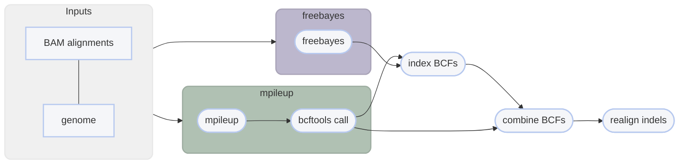

import { Aside, Badge, Card, FileTree, Tabs, TabItem } from '@astrojs/starlight/components';
import Accordion from '@/components/Accordion.astro';

 <Accordion title="📝 You will need">
- at least 4 cores/threads available
- sequence alignments: <Badge variant="success" text=".bam"/> <Badge text="coordinate-sorted"/>
    - **sample name**: <Badge variant="success" text="a-z"/> <Badge variant="success" text="0-9"/> <Badge variant="success" text="."/> <Badge variant="success" text="_"/> <Badge variant="success" text="-"/> <Badge  text="case insensitive"/>
- genome assembly in FASTA format: <Badge variant="success" text=".fasta"/> <Badge variant="success" text=".fa"/> <Badge variant="success" text=".fasta.gz"/> <Badge variant="success" text=".fa.gz"/> <Badge  text="case insensitive"/>
- (optional) sample grouping file
</Accordion>
<Accordion title="sample grouping file (optional)">
This file is optional and useful if you want variant calling to happen on a per-population level.
- takes the format of sample<i>\<tab></i>group
    - spaces can be used as delimeters too
- the groups can be numbers or text (_i.e._ meaningful population names)
- you can comment out lines with `#` for Harpy to ignore them
- create with `template groupings` or manually
- if created with `template groupings`, all the samples will be assigned to group `pop1`, so make sure to edit the second column to reflect your data correctly.

```txt title="example file for --populations"
sample1 pop1
sample2 pop1
sample3 pop2
sample4 pop1
sample5 pop3
#sample5 pop4
```

<Aside type="caution" title="Known quirk">
There's an unusual error on the Snakemake side of things that happens when the name of a sample and population are identical.
It has been unclear how to resolve this issue, so to protect yourself, it's best to make sure the population names are different
from the sample names. A simple fix would be to use underscores (`_`) to differentiate the population name.
</Aside>
</Accordion>

After reads have been aligned, _e.g._, with `align arachne`, you can use those alignment files
(`.bam`) to call variants in your data. Harpy can call SNPs and small indels using 
[bcftools mpileup](#snp-calling-workflow) or with [freebayes](#snp-calling-workflow). 
You can call SNPs with the `snp` command:

```bash title="Usage"
harpy snp method OPTIONS... REFERENCE INPUTS...
```

```bash title="Examples: calling variants with default settings"
harpy snp mpileup --threads 20 genome.fasta Align/bwa #[!ref] call variants with mpileup

harpy snp freebayes --threads 20 genome.fasta Align/bwa #[!ref] call variants with freebayes
```

## Running Options
In addition to the [common runtime options](../../getting-started/common-options), the `snp` commands are configured using these command-line arguments:


| argument                | default | description                                                                                                                                    |
| :---------------------- | :-----: | :--------------------------------------------------------------------------------------------------------------------------------------------- |
| `REFERENCE`             |         | Reference genome used for variant calling <Badge variant="tip" text="required"/>                                                               |
| `INPUTS`                |         | Files or directories containing [input BAM files](../../getting-started/common-options#input-arguments) <Badge variant="tip" text="required"/> |
| `--extra-params` `-x`   |         | Additional mpileup/freebayes arguments, in quotes                                                                                              |
| `--ploidy` `-n`         |   `2`   | Ploidy of samples                                                                                                                              |
| `--populations` `-p`    |         | Tab-delimited file of sample\<*tab*\>group                                                                                                     |
| `--regions` `-r`        | `50000` | Regions to call variants on ([see below](#regions))                                                                                            |
| `--keep-invariant` `-i` |  false  | Retain invariant/monomorphic loci                                                                                                              |

### ploidy
If you are calling haploid or diploid samples, using either `mpileup` or `freebayes` will be comparable.
However, if you need to call SNPs in polyploids (ploidy >2), then you will need to use `freebayes`, since
`mpileup` does not call variants for ploidy greater than 2.

### regions
The `--regions` (`-r`) option lets you specify the genomic regions you want to call variants on. Keep in mind that
`mpileup` uses 1-based positions for genomic intervals, whereas `freebayes` uses 0-based positions. Harpy will perform
variant calling in parallel over these invervals and they can be specified in three ways:

<Accordion title="Option 1: Call variants over entire genome">
<Card>
**input**: an integer to make fixed-size genomic intervals

```bash title="Example"
harpy snp -r 25000 genome.fasta data/mapped
```
</Card>

This is the default method (`-r 50000`), where Harpy will create 50 kbp non-overlapping genomic intervals across
the entire genome. Intervals towards the end of contigs that are shorter than the specified interval
size are still used. These invervals look like:
```
chromosome_1    1   50000
chromosome_1    50001 100000
chromosome_1    100001  121761    <- reached the end of the contig
```
</Accordion>
<Accordion title="Option 2: Call variants on exactly one genomic interval">
<Card>
**input**: a single region in the format `contig:start-end`

```bash title="Example"
harpy snp -r chrom1:2000-15000 genome.fasta data/mapped
```
</Card>

Following the `mpileup` and `freebayes` format, you can specify a single genomic interval of interest
to call variants on. This interval must be in the format `contig:start-end` where:
- `contig` is the exact name of a contig in the supplied genome
- `start` is an integer specifying the start position of the interval for that `contig`
- `end` is an integer specifying the end position of the interval for that `contig`

</Accordion>
<Accordion title="Option 3: Call variants on specific genomic intervals">
<Card>
**input**: a tab (or space) delimited file of contigs and positions

```bash title="Example"
harpy snp -r data/positions.txt genome.fasta data/mapped
```
</Card>

A BED-like file of contig<i>\<whitespace></i>start<i>\<whitespace></i>end can be provided to call variants
on only specific genomic intervals. This file will look like:
```
chromosome_1    1   45000
chromosome_1    723123 999919
chromosome_5    22421   564121
```
</Accordion>

### populations
Grouping samples changes the way the variant callers computes certain statistics when calling variants. If you
have reason to believe there is a biologically meaningful grouping scheme to your samples, then you should include
it.

## SNP calling workflow
<Tabs>
<TabItem label="details">
The workflow is parallelized over genomic intervals (`--regions`). All intermediate outputs are removed, leaving 
you only the raw variants file (in `.bcf` format), the index of that file, and some stats about it.

### SNP workflows
The `mpileup` and `call` modules from [bcftools](https://samtools.github.io/bcftools/bcftools.html) (formerly samtools)
or [Freebayes](https://github.com/freebayes/freebayes) are used to call variants from alignments. Both are very popular
variant callers to call SNPs and small indels. 


</TabItem>
<TabItem label="snp output">

The default output directory is `SNP/mpileup` or `SNP/freebayes`(depending on workflow) with the folder structure below.
Below, `contig1` and `contig2` are generic contig names from an imaginary `genome.fasta` for demonstration purposes.
The resulting folder also includes a `workflow` directory (not shown) with workflow-relevant runtime files and information.

<FileTree>
- SNP/method
  - variants.raw.bcf
  - variants.raw.bcf.csi
  - variants.normalized.bcf
  - variants.normalized.bcf.csi
  - logs
    - contig1.call.log   # mpileup only
    - contig1.METHOD.log
    - contig2.call.log   # mpileup only
    - contig2.METHOD.log
    - sample.groups
    - samples.files
    - samples.names
  - reports
    - variants.raw.ipynb
    - variants.normalized.ipynb
</FileTree>

| item                       | description                                                                              |
| :------------------------- | :--------------------------------------------------------------------------------------- |
| `variants.raw.bcf`         | vcf file produced from variant calling, contains all samples and loci                    |
| `variants.normalized.bcf`  | variants, but with indels realigned and duplicates removed                               |
| `variants.*.bcf.csi`       | index file for `variants.*.bcf`                                                          |
| `logs/*.call.log`          | what `bcftools call` writes to `stderr`                                                  |
| `logs/*.METHOD.log`        | what `bcftools mpileup` or `freebayes` writes to `stderr`                                |
| `logs/sample.groups`       | if provided, a copy of the file provided to `--populations` with commented lines removed |
| `logs/samples.files`       | list of alignment files used for variant calling                                         |
| `logs/samples.names`       | list of sample names associated with alignment files used for variant calling            |
| `reports/variants.*.ipynb` | report summarizing variants                                                              |

</TabItem>
<TabItem label="mpileup parameters">

By default, Harpy runs `mpileup` with these parameters (excluding inputs and outputs):
```bash title="How harpy calls mpileup"
bcftools mpileup --region contigname:START-END --annotate AD --output-type b --ploidy ploidy
```

The mpileup module of samtools has *a lot* of command line options. Listing them all here would be difficult to read, therefore please
refer to the [mpileup documentation](http://www.htslib.org/doc/samtools-mpileup.html#OPTIONS) to explore ways to configure your mpileup run.

</TabItem>
<TabItem label="freebayes parameters">

By default, Harpy runs `freebayes` with these parameters (excluding inputs and outputs):
```bash title="How harpy calls freebayes"
freebayes -f genome.fasta -r contigname:START-END -L bam.list -p ploidy
```

Freebayes has *a lot* of command line options. Listing them all here would be difficult to read, therefore please
refer to the [freebayes documentation](https://github.com/freebayes/freebayes#usage) to explore ways to configure your freebayes run.
</TabItem>
</Tabs>
