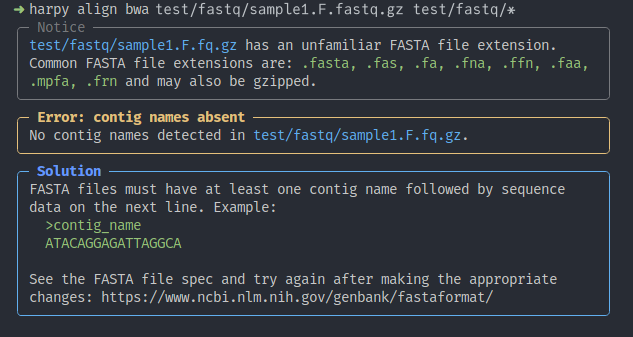

import { Badge, Steps, Tabs, TabItem } from '@astrojs/starlight/components';
import Accordion from '@/components/Accordion.astro';

Harpy is an open source program written using a combination of BASH, Go, R, 
Python, and Snakemake. This page provides information on Harpy's
development and how to contribute to it, if you were inclined to do so. If you want
a great overview of the mechanics of the internals, [check out the DeepWiki for Harpy](https://deepwiki.com/blinkseq/harpy/2-core-architecture).

<Accordion title="Design Philosophy">

Before we get into the technical details, you, dear reader, need to understand
why Harpy is the way it is. Harpy may be a pipeline for other software, but 
there is a lot of extra stuff built in to make it user 
friendly. Not just friendly, but _compassionate_. The guiding ethos for Harpy is
**"Don't hate the user"**. That means there is a lot
of code that checks input files, runtime details, etc. before 
Snakemake takes over. This is done to minimize time wasted on minor 
errors that only show their ugly heads 18 hours into a 96 hour process. With that in mind:
1. **Code should be written clearly** because someone else will need to read it at 
some point, and that person could be future-you who hasn't seen or thought 
about that code for a while. Write nicely. Annotate.
2. **Documentation is just as important as the code**. No user-facing features are undocumented,
and the documentation should read like something that a new student can
pick up and understand. Good documentation, written compassionately, will lower
the barrier of entry to people who just want to process their haplotag data. Harpy
isn't about ego, it's about accessibility. We invest in this documentation because
we **_want_** to.
3. **Error messages should provide all the information a user needs to fix the problem and retry**. It's not enough to exit when an error is identified. Collate
the things causing the error, explain to the user what and why. Harpy follows a
style of presenting and explaining the error, then providing a solution and showing exactly what files/rows/columns/etc. caused the error. Be kind to users.

</Accordion>

## Installing dev version
The easiest way to locally install the development build is to use [pixi](https://pixi.sh/latest/installation/).

<Steps>
1. Install `pixi` if you don't already have it on your system
    ```bash
    curl -fsSL https://pixi.sh/install.sh | sh
    ```
2. Clone the Harpy git repository
    ```bash
    git clone https://github.com/blinkseq/harpy.git
    ```

3. Install the necessary components into an environment and run:
    ```bash title="manually install the environment and activate the shell"
    cd harpy
    pixi run build
    pixi shell
    # harpy ...
    ```

</Steps>

## Harpy's components
### source code
Harpy runs in two stages:
<Steps>
1. Parse command line
    It recieves command line inputs and parses them
2. Configure and run workflow
    The parsed inputs configure workflows and output directories, then execute a Snakemake workflow
</Steps>

To accomplish this, Harpy is written as a Python program, using [rich-click](https://github.com/ewels/rich-click)
for the aesthetically pleasing interface. Since Harpy also relies on Snakemake
snakefiles for each module, bash scripts, python scripts, and ipynb files,
not all of it can be installed as a pure python program using `setuptools`.
The build process installs part of Harpy as a pure-python command line program, but
all the extra files Harpy needs to run need to be installed separately. All of 
this is handled by `pixi`. It's a little circuitous, but it's how
we can keep the source code modular, installable, and have the flexibility of 
using non-python code.

### bioconda recipe
For the ease of installation for end-users, Harpy has a [recipe](https://github.com/bioconda/bioconda-recipes/blob/master/recipes/harpy/meta.yaml) in Bioconda,
which makes it available for download and installation. A semi-updated copy of the recipe is also
stored in `resources/meta.yml`. The yaml file is the metadata of the package, including software 
deps and their versions. Now that Harpy is hosted on bioconda, when a new version is tagged with
a release, Bioconda will automatically create a pull request (after a delay), typically not
requiring any intervention on the development side for the newest Harpy version to be released for conda installation.


## The Harpy repository
### repo structure
Harpy exists as a Git repository on GitHub. Git is a popular version control system and 
discussing its use is out of the scope of this documentation, however there is no 
shortage of [great resources](https://www.youtube.com/watch?v=8Dd7KRpKeaE) to get 
you started. The `main` branch is the staging area for final testing and polish before
a release. All meaningful changes to the code occur on branches based on `main`, but not on `main` itself.

### development workflow
The dev workflow is reasonably standard:
<Steps>
1. Fork Harpy
    [create a fork](https://github.com/blinkseq/harpy/fork) of Harpy, usually from the `main` branch

2. Create new development branch
    Within your fork, create a new branch, name it something relevant to what you intend to do (_e.g._, `naibr_bugfix`, `add_deepvariant`)

3. Make code changes
    Add and modify code with your typical coding workflow, pushing your changes to your Harpy fork
4. Create pull request
    When it's ready for inclusion into Harpy (and testing), create a Pull Request to merge your changes into the Harpy `main` branch (unless specified otherwise)
</Steps>

### containerization
The software dependencies that the Snakemake workflows use are also maintained as pre-configured versioned
containers. Updating or editing this container can be done automatically or manually. The images follow
a convention of `<env>_<version>` tags, e.g., `harpy:align_3.2` is the tag for
the container with all the software in the conda-equivalent `align` environment for Harpy v3.2.

#### automatically
The `createrelease` GitHub Action will automatically create the multiple Dockerfiles with `harpy containerize` (a hidden harpy command)
and build the new Docker containers, then upload them to GHCR (GitHub Container Registry) with the appropriate version tag.

#### manually
The dockerfile for that container is created by using a hidden harpy command `harpy containerize`
```bash title="auto-generate Dockerfiles"
harpy containerize
```
which does all of the work for us. The result is a series of `container/env/Dockerfile` files that have all of the pixi environments and shell hooks written into them. After creating the Dockerfiles, the images must then be built with the correct tag.

```bash title="build the Docker image"
cd resources
docker build -t pdimens/harpy:env_tag container/env
```
where `env` can be e.g. `qc` and `tag` could be something like `3.3`, making the tag `qc_3.3`

Once that's done, the image can be pushed to the registry:
```bash title="push image to registry"
docker push pdimens/harpy
```

## Automations
### testing
CI (**C**ontinuous **I**ntegration) is a term describing automated actions that do
things to/with your code and are triggered by how you interact with a repository.
Harpy has a series of GitHub Actions triggered by interactions with the `main` branch (in `.github/workflows`) 
to test the Harpy modules depending on which files are being changed by the push or
pull request. It's set up such that, for example, when files associated with 
demultiplexing are altered, it will run `harpy preprocess` on the test data 
in the cloud and notify the Harpy devs if for some reason `harpy preprocess`
could not run successfully to completion. These tests do not test for accuracy,
but test for breaking behavior. You'd be shocked to find out how many errors
crop up this way and require more work so Harpy can be resilient to more use cases.
### releases
There is [an automation](https://github.com/blinkseq/harpy/blob/dev/.github/workflows/createrelease.yml)
that gets triggered every time Harpy is tagged with the new version. It strips out the unnecessary files and will
upload a cleaned tarball to the new release (reducing filesize by orders of magnitude). The automation will also
build a new Dockerfile and tag it with the same git tag for Harpy's next release and push it to Dockerhub.
In doing so, it will also replace the tag of the containers in all of Harpy's snakefiles from `latest` to the
current Harpy version. In other words, during development the containers in workflows appear as
`container: ghcr.io://pdimens/harpy:env_latest` and the automation replaces it with (e.g.) `container: ghcr.io://pdimens/harpy:env_tag`.
Same for the software version, which is kept at `0.0.0` (`pyproject.toml` and `__main__.py`) in the development version and gets replaced with the tagged version with the automation.
Tagging is easily accomplished with Git commands in the command line:
```bash
git checkout main #[!ref] make sure you're on the main branch
git tag X.X.X #[!ref] create the tag locally, where X.X.X is something like 3.7.1
git push origin X.X.X #[!ref] push the new tag to the repository
```
