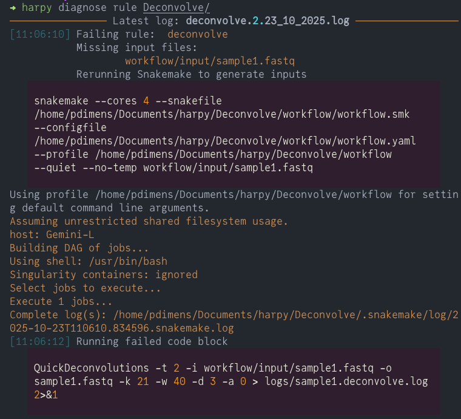

import { Badge } from '@astrojs/starlight/components';

Harpy includes a series of `diagnose` commands to faciliate troubleshooting. These are mostly a semi-automated
_attempt_ at short-cutting snakemake to rerun directly without intervening harpy code, which should help expose the
issue more obviously.


## diagnose stall
The `diagnose stall` command will run dry-run Snakemake for a workflow with the `--dry-run --debug-dag` options
and print output to try to identify why Snakemake might be stalling for a workflow.
This is typically used during development or for troubleshooting edge-cases and you're likely/hopefully
not going to need to use this feature. Similar to `resume`, this requires a Harpy-generated output folder as the sole argument.

Usage
```bash
harpy diagnose stall path/to/dir
```

Example
```bash
harpy diagnose stall Align/bwa
```

## diagnose rule <Badge text="experimental" variant="caution"/>
The [!badge corners="pill" text="diagnose rule"] command is a shortcut for trying to manually rerun a failing rule.The
command will scan the input directory for the most recent Snakemake log file and parse it to identify the first rule
triggering the workflow to fail. The input files of the failing rule will be checked for their existence, and if not,
Harpy will call Snakemake directly with `--no-temp` and the missing files as targets to ensure the creation of the missing
input files (this is skipped if all input files are present). After, the failing command will be run directly, without invoking Snakemake, in any appropriate container or conda environment.

```bash usage
harpy diagnose rule path/to/dir
```

```bash example
harpy diagnose rule Deconvolve/
```

The output walks you through what Harpy is trying to do:
